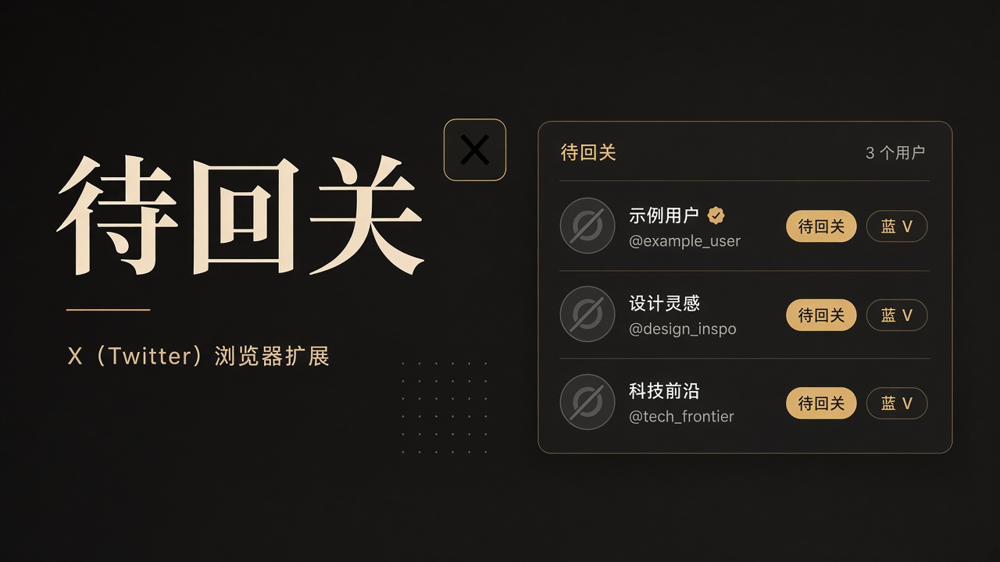
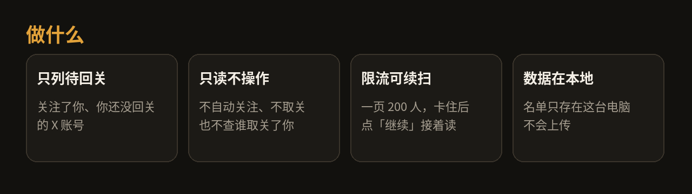
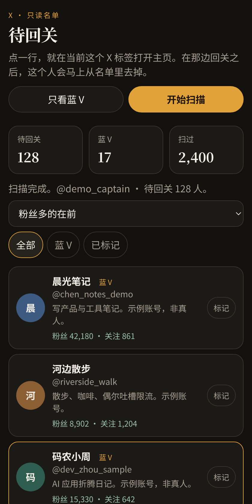
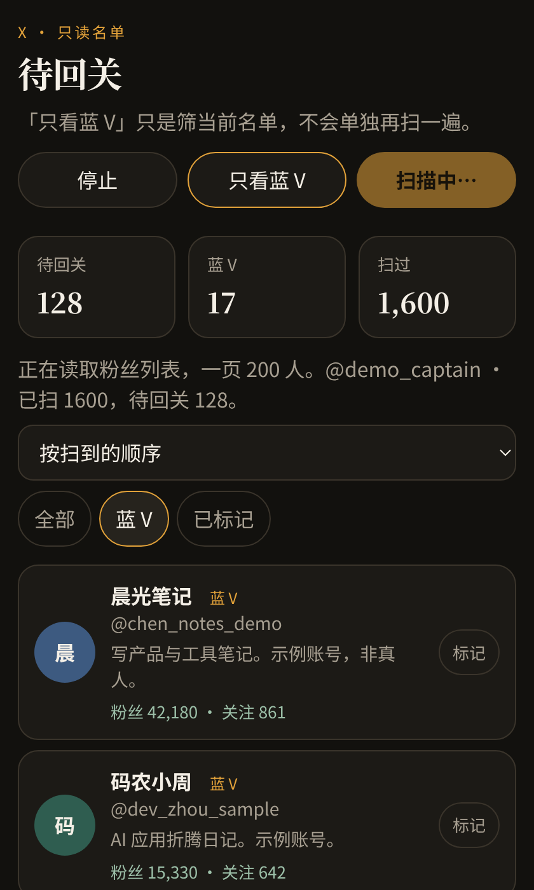

# 待回关

> X（Twitter）Chrome / Edge 扩展：列出关注了你、但你还没回关的账号。只读。



## 这是什么

**待回关**是给 [X（Twitter）](https://x.com) 用的电脑端浏览器扩展。  
它只做一件事：在侧栏里列出「关注了你，但你还没回关」的账号。



### 会做

- 用你已登录的 X 网页，按一页 **200** 人读粉丝列表
- 页与页之间自动停一秒多，减轻限流
- 被限制时记住进度，点「继续」接着扫，不从头再来
- 「只看蓝 V」筛选当前名单（蓝 V 没有单独接口）
- 点一行，在当前 X 标签打开对方主页；你回关后，侧栏会立刻去掉此人
- 营销 / 垃圾号可「标记」，之后扫描会跳过
- 支持排序、复制名单、导出 CSV
- 数据只存在本机 `chrome.storage.local`

### 不会做

- **不**自动关注、不取关
- **不**检测谁取关了你（不是 unfollowers 工具）
- **不**上传名单或账号数据
- **不**支持手机浏览器

## 界面预览

侧栏名单（示例账号，非真人）：



筛选「只看蓝 V」：



## 安装

电脑上的 **Chrome** 或 **Edge**（手机不行）。

### 方式 A：下载 Release 压缩包（推荐）

1. 打开 [Releases](https://github.com/caaaptaintop/x-fans-not-followed/releases) ，下载最新的 `x-fans-not-followed-v*.zip`
2. 解压，得到 `extension` 文件夹
3. 地址栏打开 `chrome://extensions`（Edge 为 `edge://extensions`）
4. 打开右上角「开发者模式」
5. 点「加载已解压的扩展程序」，选中解压出的 `extension` 文件夹
6. 用同一个浏览器登录 [https://x.com](https://x.com)

### 方式 B：从源码加载

```bash
git clone https://github.com/caaaptaintop/x-fans-not-followed.git
```

然后按上面第 3–6 步，选仓库里的 `extension` 文件夹。

## 怎么用

1. 打开任意 `x.com` 标签页
2. 点工具栏里的「待回关」，打开侧栏（名单只跟当前这个标签绑定）
3. 点「开始扫描」
4. 点某一行 → 在当前 X 标签打开主页 → 手动决定是否回关  
   回关后此人会从名单消失；若再取消关注且对方仍关注你，会回到名单
5. 觉得是营销号，点行右侧「标记」；可在「已标记」里撤销
6. 需要时用「复制名单」或「导出 CSV」

更细的说明见 [`extension/使用说明.txt`](extension/使用说明.txt)。

## 隐私

- 名单、标记、扫描进度只存在**这台电脑**的浏览器本地存储
- 扩展不向作者或其他服务器上传数据
- 仅请求访问 `https://x.com/*` 与 `https://twitter.com/*`，用于读取你已登录会话下的粉丝关系

## 常见问题

**扫到一半停了？**  
多半是限流。等一会儿点「继续」，会从停下的那一页接着读。

**「只看蓝 V」人很少？**  
蓝 V 是从同一份待回关名单里筛出来的，不会单独再扫一遍。

**装过旧版？**  
到扩展管理页对该扩展点「重新加载」。

**会不会被 X 封号？**  
本扩展只读、带页间停顿，但仍建议正常使用、不要短时间反复狂扫。风险自负。

## 版本

当前扩展版本：**1.5.0**（见 `extension/manifest.json`）。  
更新与安装包：https://github.com/caaaptaintop/x-fans-not-followed/releases

## 说明

个人自用工具开源分享，按现状提供，无保证。  
未附带许可证文件；使用前请自行评估。

## 许可

本项目采用 [MIT License](LICENSE)。
